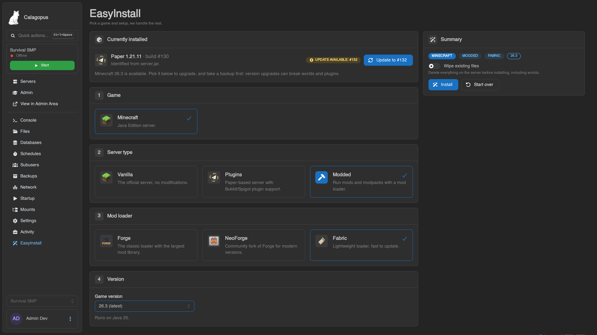
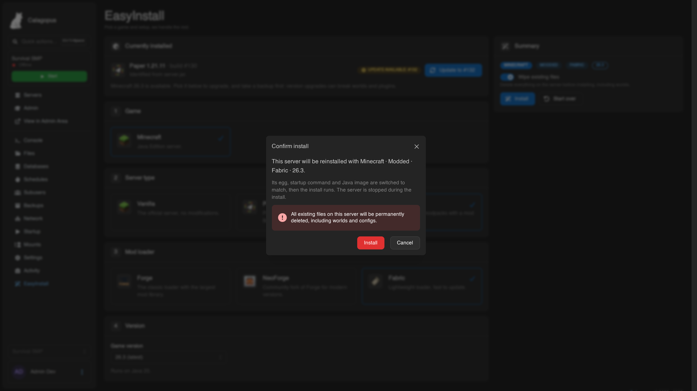

# EasyInstall

A [Calagopus](https://github.com/calagopus/panel) panel extension that lets server owners install a game server in a few clicks: pick the game, the server type and the version, and EasyInstall switches the server to the right egg, Java image and variables, then reinstalls it. It also shows what is currently installed and offers a one-click update when a newer build is out.

Minecraft is supported today (Vanilla, Paper, Forge, NeoForge and Fabric), with versions and builds coming from [MCJars](https://mcjars.app).

## Features

- **Guided install.** Game → server type (Vanilla / Plugins / Modded) → mod loader (Forge / NeoForge / Fabric) → version. Versions are live from MCJars and the page shows which Java version the selection needs.
- **Optional wipe.** Keep the server's files or start clean, with a confirmation step that spells out what happens.
- **Currently installed.** Identifies the installed build from the `server.jar` hash, falling back to the build EasyInstall recorded at install time.
- **One-click updates.** When a newer build of the installed version exists, *Update* reinstalls it without touching worlds, configs or mods. Newer Minecraft versions are pointed out but never applied automatically.
- **Matching Java image.** The egg's `Java N` image for the version, or the closest newer one.
- **Activity log.** Installs and updates are recorded in the server's activity log.
- **Update notifications.** New EasyInstall releases show up on the panel's *Admin → Updates* page.

## Requirements

- Calagopus panel **1.2.9 or newer**, on the `:heavy` image (or a source install) so extensions can be installed.
- A Minecraft egg with `SOFTWARE`, `VERSION` and `BUILD` variables and `Java N` docker images, such as the *Minecraft: MCJars + Modpack Support* egg.

## Installation

1. Download `dev_cosmii02_easyinstall.c7s.zip` from the [latest release](https://github.com/cosmii02/calagopus-easyinstall/releases/latest).
2. In the panel, go to **Admin → Extensions** and upload it. The panel compiles it and restarts, usually within a minute or two.
3. Open the extension's **Configure** page and pick the Minecraft egg.

To update, upload the new release's `.c7s.zip` the same way. Settings are kept.

## Usage

Server owners find **EasyInstall** in the server sidebar. It is shown to users who are allowed to reinstall the server (`settings.install`); through EasyInstall they can switch the server's egg and Java image even without the separate startup permissions.

## How it works

Installing switches the server to the configured egg, sets its startup command and Java image, writes `SOFTWARE`, `VERSION` and the exact MCJars build id to `BUILD`, then runs the panel's normal reinstall. The egg's install script does the download, so EasyInstall works with any egg that follows the MCJars variable convention.

## Development

The repository root is the extension directory. Mount or copy it into a panel checkout as `backend-extensions/dev_cosmii02_easyinstall`; see the [Calagopus extension docs](https://calagopus.com/docs/panel/extensions) for the development environment.

CI (`.github/workflows/build.yml`) lints, type-checks and packages every push against a pinned panel release. To publish a release, bump `version` in `Cargo.toml` and push to `main`: CI creates `v<version>` with the `.c7s.zip` attached.

## License

[MIT](LICENSE)
