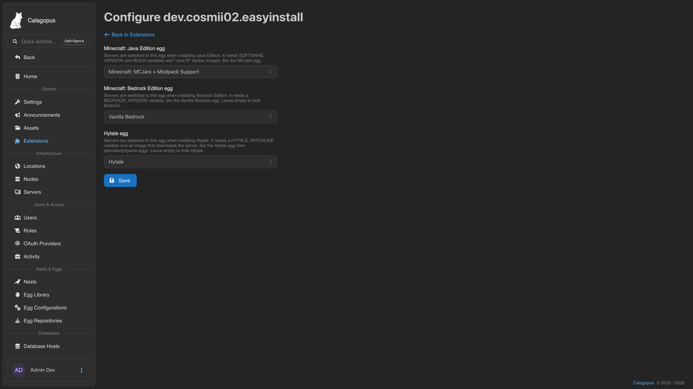

# EasyInstall

A [Calagopus](https://github.com/calagopus/panel) panel extension that lets server owners install a game server in a few clicks: pick the game, the server type and the version, and EasyInstall switches the server to the right egg, image and variables, then reinstalls it. It also shows what is currently installed and offers a one-click update when a newer build is out.

Supported today:

- **Minecraft: Java Edition** (Vanilla, Paper, Forge, NeoForge and Fabric), with versions and builds from [MCJars](https://mcjars.app).
- **Minecraft: Bedrock Edition** (the official Bedrock Dedicated Server), with versions from Mojang and the [BDS-Versions](https://github.com/Bedrock-OSS/BDS-Versions) list.
- **Hytale** (the official dedicated server), on the Release or Pre-release branch.

## Features

- **Guided install.** Game → server type (Vanilla / Plugins / Modded) → mod loader (Forge / NeoForge / Fabric) → version. Versions are live from MCJars and the page shows which Java version the selection needs. Bedrock goes straight from the game to the version; Hytale only asks for the branch, since Hytale's downloader always installs the newest build of it.
- **Optional wipe.** Keep the server's files or start clean, with a confirmation step that spells out what happens.
- **Currently installed.** Identifies the installed Java build from the `server.jar` hash, falling back to the build EasyInstall recorded at install time. Bedrock is read from the pinned `BEDROCK_VERSION`, Hytale from the `version` file its image writes.
- **One-click updates.** When a newer build of the installed Java version exists, *Update* reinstalls it without touching worlds, configs or mods; newer Minecraft versions are pointed out but never applied automatically. Bedrock updates go to the newest release, since Bedrock clients update themselves and can't join an older server. Hytale servers update themselves on every start, so there is nothing to update from EasyInstall.
- **Matching Java image.** The egg's `Java N` image for the version, or the closest newer one.
- **Activity log.** Installs and updates are recorded in the server's activity log.
- **Update notifications.** New EasyInstall releases show up on the panel's *Admin → Updates* page.

## Requirements

- Calagopus panel **1.2.9 or newer**, on the `:heavy` image (or a source install) so extensions can be installed.
- For Java Edition: an egg with `SOFTWARE`, `VERSION` and `BUILD` variables and `Java N` docker images, such as the *Minecraft: MCJars + Modpack Support* egg.
- For Bedrock Edition: an egg with a `BEDROCK_VERSION` variable, such as *Vanilla Bedrock* from [pterodactyl/game-eggs](https://github.com/pterodactyl/game-eggs/tree/main/minecraft/bedrock/bedrock). Mojang only ships the server for x86_64, so Bedrock servers need an x86_64 node.
- For Hytale: an egg with a `HYTALE_PATCHLINE` variable whose image downloads the server, such as *Hytale* from [pterodactyl/game-eggs](https://github.com/pterodactyl/game-eggs/tree/main/hytale). On the first start the console shows a link to sign in with a Hytale account (that's what downloads the server), and once it has booted the server is authenticated with `/auth login device`. Hytale's downloader is x86_64 only.

Each game is optional: only games with an egg configured are offered to users.

## Installation

1. Download `dev_cosmii02_easyinstall.c7s.zip` from the [latest release](https://github.com/cosmii02/calagopus-easyinstall/releases/latest).
2. In the panel, go to **Admin → Extensions** and upload it. The panel compiles it and restarts, usually within a minute or two.
3. Open the extension's **Configure** page and pick the eggs for the games you want to offer.

To update, upload the new release's `.c7s.zip` the same way. Settings are kept.

## Usage

Server owners find **EasyInstall** in the server sidebar. It is shown to users who are allowed to reinstall the server (`settings.install`); through EasyInstall they can switch the server's egg and Java image even without the separate startup permissions.

## How it works

Installing switches the server to the configured egg, sets its startup command and docker image, writes the version variables, then runs the panel's normal reinstall. For Java that is `SOFTWARE`, `VERSION` and the exact MCJars build id in `BUILD`; for Bedrock it is the exact version in `BEDROCK_VERSION`; for Hytale the branch in `HYTALE_PATCHLINE`, with the image downloading the server when it first starts. The egg's install script does the download, so EasyInstall works with any egg that follows these variable conventions.

## Development

The repository root is the extension directory. Mount or copy it into a panel checkout as `backend-extensions/dev_cosmii02_easyinstall`; see the [Calagopus extension docs](https://calagopus.com/docs/panel/extensions) for the development environment.

CI (`.github/workflows/build.yml`) lints, type-checks and packages every push against a pinned panel release. To publish a release, bump `version` in `Cargo.toml` and push to `main`: CI creates `v<version>` with the `.c7s.zip` attached.

## License

[MIT](LICENSE)
